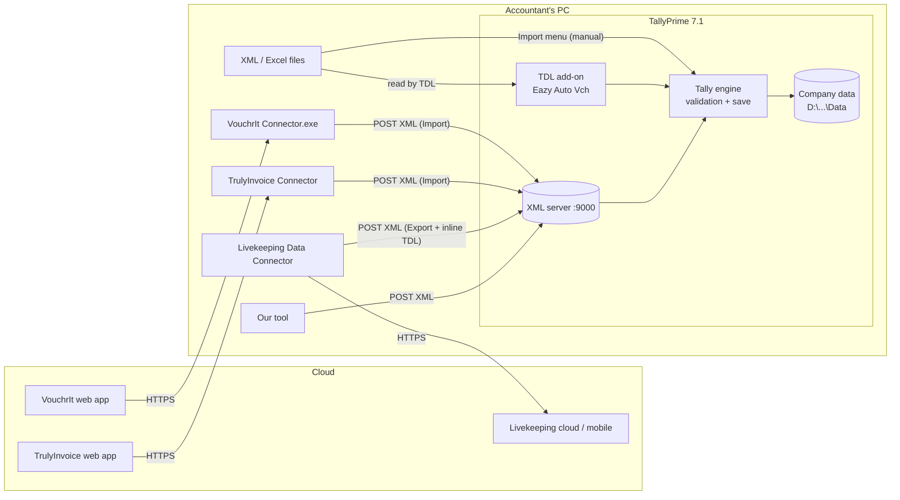

# 02 · How data travels from third-party software into Tally

**Short answer:** no tool writes into Tally's data files directly. TallyPrime has a **built-in web server** (default `http://localhost:9000`). Tools **POST an XML document** to it, and Tally then validates the data, saves it like a manual entry and replies with an XML result. Even the "cloud" tools rely on a small **connector app** on this PC that relays data from the cloud to that local port.

## The 4 routes into Tally



| # | Route | Used by (on this PC) | Direction | Notes |
|---|---|---|---|---|
| 1 | **XML over HTTP** to `localhost:9000` | VouchrIt, TrulyInvoice, Livekeeping, **us** | Both (import and export) | The official integration method. Tally must be running, with the company loaded. |
| 2 | **TDL add-on** (`.tcp`) inside Tally | Eazy Auto Vch | Inside Tally | Adds menus to Tally, reads Excel, creates vouchers. No external app is needed, but it is written in Tally's own language (TDL). |
| 3 | **File import** (Import › Transactions) | The `Sales_*.xml` files we found | One-way | Same XML as route 1, but saved to a file and imported by hand. |
| 4 | **ODBC** (port 9002 here) | Excel / Power BI | Mostly read | Good for reports, not for creating vouchers. |

## Step by step: one voucher through route 1

1. **The user acts** in the tool, for example by uploading a bank statement and approving the rows.
2. **The tool builds XML.** Every voucher becomes a `<VOUCHER>` block with date, voucher type, party and ledger lines (debits are negative amounts, credits are positive).
3. **The connector POSTs the XML** to `http://localhost:9000`. Cloud tools first download the job from their server, then post it locally.
4. **Tally processes it.** It checks that the ledgers exist, the voucher type is valid, the amounts balance and the date falls in the financial year. Then it saves the voucher exactly as if it had been typed in.
5. **Tally replies:**
   ```xml
   <RESPONSE><CREATED>1</CREATED><ALTERED>0</ALTERED><ERRORS>0</ERRORS>
     <LASTVCHID>4521</LASTVCHID></RESPONSE>
   ```
   On failure the reply contains `<LINEERROR>Ledger 'XYZ' does not exist!</LINEERROR>`.
6. **The tool shows the result** to the user and retries or fixes the rows that failed.

Reading data works the same way, in reverse. The tool sends an `Export` request, often with a small inline TDL definition, as the Livekeeping log shows with "My Trial Balance" and "My Ledger Outstandings". Tally replies with the data as XML.

## Prerequisites in Tally (one-time)

`F1 (Help) › Settings › Connectivity › Client/Server configuration`
- TallyPrime acts as: **Both** (or Server)
- Port: **9000** (the default; record it if it is different)
- The company must be **open** in Tally. Requests go to the company named in `SVCURRENTCOMPANY`.

## What this means for us

We use **route 1**, the same door the paid tools use. Our tool therefore never touches Tally's data files, can't corrupt the database, and everything it creates passes through Tally's own validation. Our extra value comes **before** the POST: parsing, ledger mapping and the review screen.
