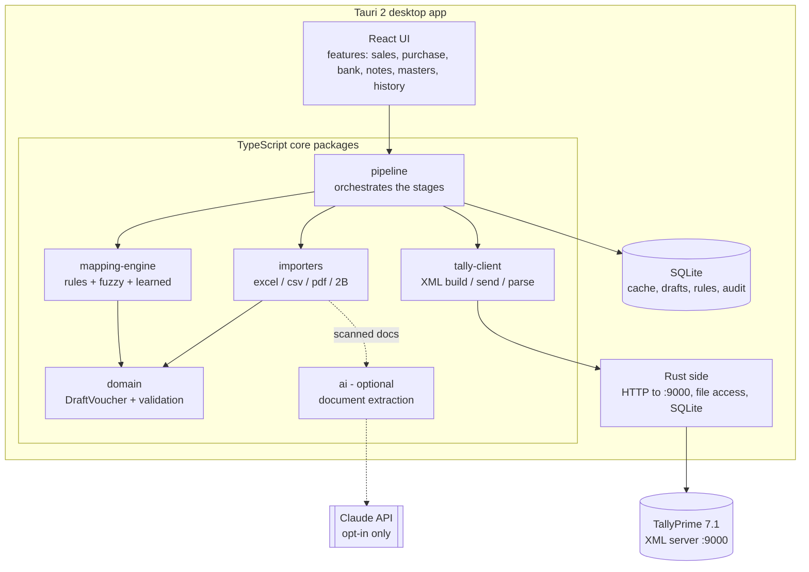
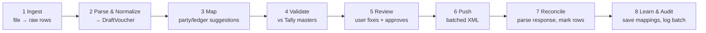

# 05 · System Architecture

## 5.1 Principles

1. **Tally is the source of truth.** We hold a *cache* of masters and a *staging area* for drafts, never a second set of books.
2. **One door into Tally:** the XML/HTTP API on `localhost:9000`, wrapped in a single package (`tally-client`).
3. **One pipeline for every module:** every source becomes the same canonical `DraftVoucher`, so validation, review, push and undo are written once.
4. **Pure core, thin shell.** Business logic lives in framework-free TypeScript packages that can be unit tested without Tally or a UI. The desktop shell (Tauri) only does I/O.
5. **Local first and private by default.** SQLite on disk, and no network except localhost. Cloud AI requires explicit opt-in.
6. **Idempotent and auditable.** Every push carries a deterministic ID and is logged, so it can be retried and undone.

## 5.2 High-level view



Why do Tally calls go through Rust? Tally's HTTP server sends no CORS headers, so a webview `fetch` to `localhost:9000` is blocked. The Tauri HTTP plugin (Rust) makes the call instead, and it can also enforce a **localhost-only allow-list**.

## 5.3 The pipeline (same for every module)



| Stage | Package | Notes |
|---|---|---|
| Ingest | `importers` | Detects the format. Column-mapping templates are saved per company and per source. |
| Normalize | `domain` | Dates go to `YYYYMMDD`. Amounts are stored as integer **paise**, never as floats. Narration is cleaned up. |
| Map | `mapping-engine` | Order of precedence: exact rule → learned mapping → GSTIN match → fuzzy name → suspense ledger. A confidence score is attached. |
| Validate | `domain` | Debit = credit, ledgers exist, voucher type exists, date is within the FY, GST split is correct, the row is not a duplicate. |
| Review | `apps/desktop` | Grid with 🟢 ready, 🟡 low confidence, 🔴 error. Missing ledgers can be created inline. |
| Push | `tally-client` | Batches of 50–200 vouchers. Each voucher gets a deterministic `REMOTEID` (hash of company, source file and row). |
| Reconcile | `tally-client` | Reads `CREATED/ALTERED/ERRORS/LINEERROR` and maps each error back to its row. |
| Learn & Audit | `mapping-engine`, `storage` | User corrections become learned rules. The batch is logged together with the XML that was sent. |

## 5.4 Canonical domain model (simplified)

```ts
type Paise = number; // integer, 100 = ₹1.00

interface DraftVoucher {
  id: string;                 // local UUID
  remoteId: string;           // deterministic, sent to Tally for idempotency
  companyId: string;
  kind: 'sales' | 'purchase' | 'receipt' | 'payment' | 'contra'
      | 'credit_note' | 'debit_note' | 'journal';
  voucherType: string;        // actual Tally voucher type name, e.g. "RSPL CASH SALE"
  date: string;               // YYYYMMDD
  number?: string;
  reference?: { no: string; date?: string }; // supplier invoice no.
  partyLedger?: string;
  narration?: string;
  lines: LedgerLine[];        // must sum to 0
  items?: InventoryLine[];    // item-invoice mode only
  source: { batchId: string; file: string; row: number };
  status: 'draft' | 'ready' | 'error' | 'pushed' | 'failed';
  issues: Issue[];
}

interface LedgerLine {
  ledger: string;
  amount: Paise;              // + debit, − credit (converted to Tally signs at the edge)
  billAllocations?: { name: string; type: 'New Ref' | 'Agst Ref' | 'On Account'; amount: Paise }[];
  bankAllocation?: { instrumentNo?: string; instrumentDate?: string; txnType?: string };
}
```

Tally's own sign convention (debit = negative with `ISDEEMEDPOSITIVE=Yes`) is applied **only** inside `tally-client`. The rest of the app uses the conventional + for debit.

## 5.5 Local database (SQLite)

| Table | Purpose |
|---|---|
| `companies` | Tally companies seen, with the last sync time |
| `ledgers`, `groups`, `voucher_types`, `stock_items`, `units` | Master cache (refreshed on company switch or on demand) |
| `import_templates` | Saved column mappings per company and source (e.g. "SBI Excel", "Busy sales export") |
| `mapping_rules` | Explicit rules: `narration contains "NEFT*AMAZON" → ledger "Amazon Seller"` |
| `learned_mappings` | Auto-learned key → ledger, with hit count and last-used date |
| `batches` | One per import: source, counts and status |
| `draft_vouchers`, `draft_lines` | Staging area |
| `push_log` | Request and response XML per chunk, plus timings (for support and undo) |
| `settings` | Tally host/port, AI opt-in, UI preferences |

Migrations are versioned (Drizzle ORM). The DB lives at `%APPDATA%\TallyHelper\data.db` and is backed up automatically before each migration.

## 5.6 Repository layout (monorepo)

```
tally-helper/
├─ apps/
│  └─ desktop/                  Tauri 2 + React app
│     ├─ src/
│     │  ├─ app/                routing, providers, layout shell
│     │  ├─ features/           one folder per module (sales, purchase, bank, notes, masters, history, settings)
│     │  ├─ components/         shared UI (ReviewGrid, Stepper, LedgerPicker, CompanySwitcher)
│     │  └─ lib/                bridges to core packages + Tauri commands
│     └─ src-tauri/             Rust: http allow-list, fs, sqlite plugin, updater
├─ packages/
│  ├─ domain/                   models, zod schemas, validation, GST math, money
│  ├─ tally-client/             XML builders, transport interface, response parser, collections
│  ├─ importers/                excel, csv, bank-pdf (per bank), gstr2b
│  ├─ mapping-engine/           rules, learned mappings, fuzzy matcher
│  ├─ pipeline/                 stage orchestration, batching, idempotency
│  ├─ storage/                  drizzle schema, migrations, repositories
│  └─ ai/                       optional extraction provider (interface + Claude impl)
├─ tools/
│  └─ tally-mock/               fake Tally XML server for tests and demos
├─ fixtures/                    ANONYMISED sample files only
└─ docs/
```

**Dependency rule (enforced by lint):**
`apps → pipeline → (importers, mapping-engine, tally-client, storage, ai) → domain`.
`domain` depends on nothing. No package imports from `apps`.

## 5.7 Cross-cutting concerns

- **Errors:** typed `Result<T, AppError>` in the core. Tally errors are translated into plain language ("Ledger *ABC* not found. Create it?").
- **Logging:** structured JSON logs with daily rotation (about 5 files max). This avoids repeating the 185 MB `tallyhttp.log` problem.
- **Config:** Tally host/port can be auto-detected (try 9000 and read `tally.ini`) and overridden in Settings.
- **Concurrency:** one push queue per company. Tally is single-threaded, so we never hammer it, which also helps avoid the socket exhaustion seen in [01](01-discovery-findings.md).
- **Updates:** Tauri updater with signed releases.
- **Undo:** delete by `REMOTEID` for every voucher in a batch, with a confirm screen.
