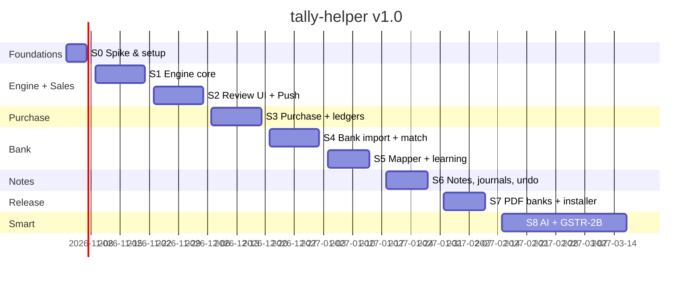

# 12 · Roadmap: from zero to v1.0 (step by step)

> Assumes 1–2 developers working in 2-week sprints, starting **Mon 2 Nov 2026**. Dates are targets, not promises.
> Every milestone ends with something **your relative uses on real client work**.

## At a glance

| Milestone | Target | What the accountant can do after it |
|---|---|---|
| **M0 · Foundations** | 6 Nov | Nothing yet. We have proven that we can talk to Tally safely. |
| **M1 · Sales live** | 4 Dec | Import a month's sales Excel → review → push to Tally |
| **M2 · Purchase live** | 18 Dec | Same for purchases, plus missing party ledgers auto-created with GSTIN |
| **M3 · Bank live** | 15 Jan | Bank Excel → auto Receipt/Payment/Contra, skips entries already in Tally, learns ledgers |
| **M4 · Notes & Journals** | 29 Jan | Credit/Debit notes linked to original invoices, journal import, History + Undo |
| **M5 · v1.0 Release** | 12 Feb | Installer, auto-update, PDF bank statements for his top banks |
| **M6 · v1.1 Smart** | Mar 2027 | Scanned invoice → purchase (AI, opt-in), GSTR-2B matching |

---

## S0 · Spike & Foundations (2–6 Nov) → **M0**
**Goal:** remove the biggest unknowns before writing product code.

| Task | Done when |
|---|---|
| Create **"TH Test Co"** in Tally 7.1 with GST on, 5 parties, 2 banks and tax ledgers | The company exists, and we never use client books for testing |
| Enable the XML server on :9000 | `GET /` returns "TallyPrime Server is Running" |
| Script: list companies, ledgers, voucher types (with base type) | JSON dumped to the console |
| Push 1 Sales, 1 Purchase, 1 Payment, 1 Receipt, 1 Credit Note | All visible in Day Book, with the sign convention confirmed |
| **REMOTEID test:** re-push the same voucher; then delete by REMOTEID | The alter vs duplicate behaviour is written into [07 §7.11](07-tally-xml-reference.md) |
| Export 1 GST ledger and 1 item invoice as XML from Tally | Exact 7.1 tags recorded |
| Monorepo (pnpm + Turbo), empty Tauri app, CI (lint + test), import-boundary lint rule | `pnpm dev` opens a blank window and CI is green |

**Risk gate:** if REMOTEID doesn't make re-pushes safe, switch to the fallback: a pre-push duplicate check against `tally_voucher_index` only.

---

## S1 · Engine core (9–20 Nov)
**Goal:** a file goes in and balanced draft vouchers come out, with no UI yet.

| Package | Deliverable |
|---|---|
| `domain` | `DraftVoucher`, `LedgerLine`, money (paise), GST split, GSTIN validator, common validators |
| `storage` | DB groups A, B and C + `draft_*` tables ([15](15-database-design.md)), migrations, repositories |
| `tally-client` | transport (via Tauri HTTP), Export collections, Import builder, response parser, **chunk + bisect** |
| `importers` | xlsx/csv reader, header fingerprint, template apply |
| `pipeline` | `ModuleAdapter` interface ([16](16-module-implementation-playbook.md)), **Sales adapter** |
| `tools/tally-mock` | Accepts Import/Export and returns realistic responses and LINEERRORs |
| `sync` | AlterID incremental sync of masters + vouchers into the local mirror, deletion reconcile ([17](17-sync-and-company-workspace.md)) |

**Exit:** a CLI test turns `fixtures/sales_sample.xlsx` into drafts, pushes them to tally-mock and then to TH Test Co, and all are created.

## S2 · Review UI + Push (23 Nov – 4 Dec) → **M1 Sales live**
| Area | Deliverable |
|---|---|
| Shell | Sidebar, CompanySwitcher, Tally status pill, Settings (host/port) |
| **Company Workspace** | Company list → open company → Overview, Day Book, Parties (GSTIN, phone, balance), Sales/Purchase lists, all read from the local mirror |
| Onboarding | Detect Tally, pick companies, sync masters, **tax-ledger setup wizard** (fills `tax_ledger_map`) |
| Flow | Stepper: Upload → **ColumnMapper** (save template) → **ReviewGrid** → PushDialog → ResultPanel |
| ReviewGrid | Virtualised, 🟢🟡🔴 filter, inline LedgerPicker, row expand, totals footer, keyboard nav |
| Push | Progress, pause, retry failed, per-row errors in plain language |

**Exit / demo:** your relative imports **one real month of sales for one client** on his PC. We sit with him and note every confusion → backlog.

## S3 · Purchase + ledger creation (7–18 Dec) → **M2 Purchase live**
- Purchase adapter (reuses the GST builder), supplier invoice no./date → `REFERENCE`
- `pending_ledgers`: "Create ledger" from the grid, pre-filled from GSTIN (state, registration type), created **before** the vouchers are pushed
- Duplicate check across the FY (party + supplier invoice no.) using `tally_voucher_index`
- Template defaults: expense ledger instead of a purchase ledger
- **Single-entry form** (`+ New`): one Sales/Purchase/Receipt/Payment typed in the app, with party auto-complete and GST split, pushed as a batch of 1

**Exit:** one real month of purchases for one client, including at least 3 new suppliers auto-created.

## S4 · Bank import + matching (21 Dec – 1 Jan)
- Bank adapter: Excel/CSV, split vs signed amounts, `bank_statements` continuity check
- Sync `tally_voucher_index` for the statement period, auto-mark rows as `already_in_tally`
- Receipt/Payment/Contra building with `BANKALLOCATIONS` (UTR/cheque parsing)
- Split a row into multiple ledgers

## S5 · Mapper + learning (4–15 Jan) → **M3 Bank live**
- Mapper chain: rules → learned → contra detection → fuzzy party → suspense
- Narration normaliser + `learned_mappings`, "Apply to similar rows", "Always do this → rule"
- Rules manager screen (list, edit, test a pattern against a sample narration)
- Bill-wise: suggest `pending_bills` with the same amount as Agst Ref

**Exit:** a full month of bank entries for a client in **under 15 minutes**. The second month should need about half the manual picks (learning works).

## S6 · Notes, Journals, History & Undo (18–29 Jan) → **M4**
- Credit Note and Debit Note adapters, original-invoice lookup, value check
- Journal adapter (Dr/Cr columns, group by voucher no.)
- History screen: batches, filters, open a batch, re-download the push log
- **Undo batch** (delete by REMOTEID, confirm screen, audit event)

## S7 · Release hardening (1–12 Feb) → **M5 v1.0**
- PDF text parsers for **the 2–3 banks he actually uses** (from his real statements, anonymised into fixtures)
- MSI installer, signed auto-update, crash log to file, log rotation
- Backup/restore of rules + learned mappings; DB backup before migrations
- Performance pass: 1,000-row bank file reviewed smoothly on the i3 with 8 GB
- Help: inline tips, a 2-minute demo company flow, a short Marathi/Hindi glossary

**Exit:** your relative uninstalls/disables at least one paid tool.

## S8+ · v1.1 Smart features (Feb–Mar 2027) → **M6**
- `ai` package: scanned invoice → purchase record; scanned statement → rows (Claude API, opt-in per document)
- GSTR-2B JSON import → match against purchase register → push missing / flag mismatches
- AI narration classification for rows still in suspense (batched, low cost)

---

## Ways of working
- **Every sprint ends with a 30-minute session with your relative** on his real work. His feedback drives the next sprint.
- **Definition of Done:** unit plus golden-XML tests, passes on tally-mock in CI, manually verified on TH Test Co, docs updated, no real data committed.
- **Branching:** `feat/*` → `dev` (CI) → `main` at each milestone, tagged `v0.M.x`.

## Risk register
| Risk | Impact | Mitigation |
|---|---|---|
| REMOTEID doesn't prevent duplicates on 7.1 | Duplicate vouchers | S0 test; fallback to a pre-push index check; Undo batch |
| Bank PDF formats vary or change | Parser breaks | Excel-first; per-bank versioned parsers; AI fallback (v1.1) |
| Tally freezes on big pushes | Bad UX | Chunks of 50, single in-flight request, pause button |
| Custom voucher types / GST setups differ per client | Wrong ledgers | Setup wizard per company; `tax_ledger_map`; review step mandatory |
| Weak PC | Slow app | Tauri, virtualised grid, SQLite indexes, perf test in S7 |
| Tally upgrade changes XML tags | Push errors | Golden tests + quick check on each Tally release using TH Test Co |
| Client data leakage | Trust/legal | Local-only by default, opt-in AI, no real data in repo ([13](13-security-privacy.md)) |
