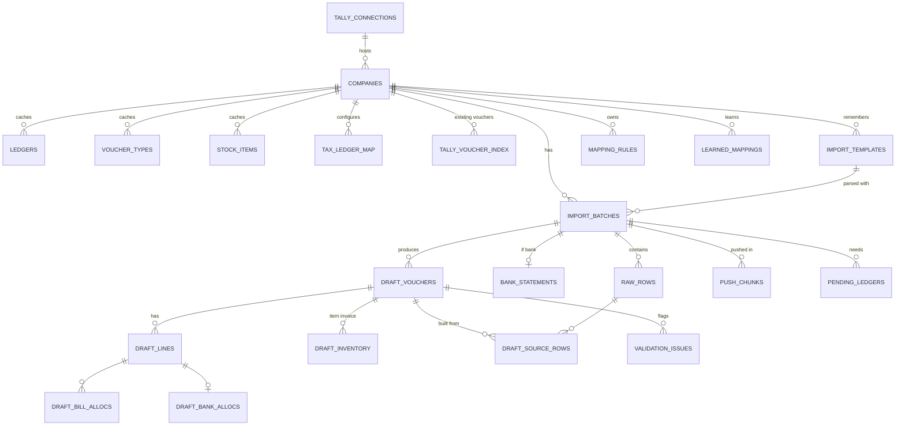
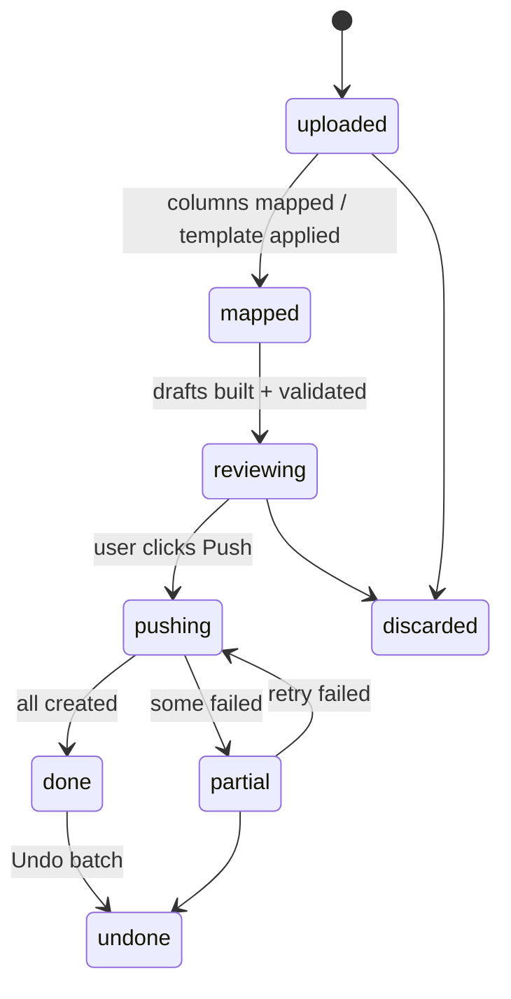

# 15 · Database Design (SQLite, local)

> Owner: `packages/storage` · Engine: SQLite 3 (WAL mode) via Drizzle ORM · File: `%APPDATA%\TallyHelper\data.db`

## 15.1 Design principles

| # | Principle | Consequence |
|---|---|---|
| 1 | **Tally is the system of record** | Master tables are a *cache* (`synced_at`, `alter_id`) and can be wiped and rebuilt at any time. |
| 2 | **Staging, not books** | Drafts live in `draft_*` tables until pushed, and are kept afterwards for audit and undo. |
| 3 | **Keep the original** | Every uploaded row is stored unchanged (`raw_rows`), so any voucher can be traced back to its Excel row. |
| 4 | **Money = INTEGER paise** | No REAL columns for money, ever. +ve = Debit, −ve = Credit (conventional sign). |
| 5 | **Company-scoped everything** | Every business table has `company_id`, and every query filters on it. |
| 6 | **Idempotency in the schema** | `draft_vouchers.remote_id` is UNIQUE and is deterministic from (company, file hash, row group). |
| 7 | **Text IDs** | Primary keys are ULIDs (sortable, generated offline), so there are no collisions if data is ever merged. |
| 8 | **Append-only audit** | `push_chunks` and `audit_events` are never updated, only inserted. |

## 15.2 Entity map



## 15.3 Table groups

| Group | Tables | Lifetime |
|---|---|---|
| A. Setup | `app_settings`, `tally_connections`, `companies` | Permanent |
| B. Master cache | `tally_groups`, `ledgers`, `ledger_aliases`, `voucher_types`, `stock_items`, `units`, `tax_ledger_map`, `pending_bills`, `tally_voucher_index` | Rebuildable from Tally |
| C. Import | `import_templates`, `import_batches`, `raw_rows`, `bank_statements` | Kept 2 years (configurable) |
| D. Drafts | `draft_vouchers`, `draft_lines`, `draft_inventory`, `draft_bill_allocs`, `draft_bank_allocs`, `draft_source_rows`, `validation_issues`, `pending_ledgers` | Kept with their batch |
| E. Intelligence | `mapping_rules`, `learned_mappings` | Permanent (the app's "brain") |
| F. Audit | `push_chunks`, `audit_events` | Append-only |

## 15.4 DDL

```sql
PRAGMA journal_mode = WAL;
PRAGMA foreign_keys = ON;

-- ───────────── A. SETUP ─────────────
CREATE TABLE app_settings (
  key         TEXT PRIMARY KEY,
  value_json  TEXT NOT NULL,
  updated_at  TEXT NOT NULL DEFAULT (datetime('now'))
);

CREATE TABLE tally_connections (
  id             TEXT PRIMARY KEY,
  label          TEXT NOT NULL,                 -- "This PC"
  host           TEXT NOT NULL DEFAULT 'localhost',
  port           INTEGER NOT NULL DEFAULT 9000,
  tally_version  TEXT,                          -- "7.1 Build 29327"
  is_default     INTEGER NOT NULL DEFAULT 0,
  last_seen_at   TEXT
);

CREATE TABLE companies (
  id                    TEXT PRIMARY KEY,
  connection_id         TEXT NOT NULL REFERENCES tally_connections(id),
  tally_name            TEXT NOT NULL,          -- exact SVCURRENTCOMPANY value
  tally_guid            TEXT,
  display_name          TEXT NOT NULL,          -- short name shown in UI
  fy_start              TEXT NOT NULL,          -- YYYYMMDD
  books_from            TEXT NOT NULL,
  gstin                 TEXT,
  state_code            TEXT,                   -- '27' Maharashtra
  default_round_off_ledger TEXT,
  default_suspense_ledger  TEXT,
  ai_enabled            INTEGER NOT NULL DEFAULT 0,
  is_active             INTEGER NOT NULL DEFAULT 1,
  last_master_sync_at   TEXT,
  UNIQUE (connection_id, tally_name)
);

-- ───────────── B. MASTER CACHE ─────────────
CREATE TABLE tally_groups (
  company_id     TEXT NOT NULL REFERENCES companies(id) ON DELETE CASCADE,
  name           TEXT NOT NULL,
  parent         TEXT,
  primary_group  TEXT NOT NULL,                 -- 'Sundry Debtors', 'Bank Accounts', ...
  nature         TEXT CHECK (nature IN ('asset','liability','income','expense')),
  PRIMARY KEY (company_id, name)
);

CREATE TABLE ledgers (
  id              TEXT PRIMARY KEY,
  company_id      TEXT NOT NULL REFERENCES companies(id) ON DELETE CASCADE,
  name            TEXT NOT NULL,                -- exact Tally name
  name_norm       TEXT NOT NULL,                -- uppercase, no M/s, Pvt Ltd, punctuation
  parent_group    TEXT NOT NULL,
  primary_group   TEXT NOT NULL,
  kind            TEXT NOT NULL CHECK (kind IN
                   ('party_debtor','party_creditor','bank','cash','sales','purchase',
                    'duty_tax','expense','income','other')),
  gstin           TEXT,
  gst_reg_type    TEXT,                         -- Regular / Composition / Unregistered/Consumer
  state_code      TEXT,
  is_billwise     INTEGER NOT NULL DEFAULT 0,
  closing_paise   INTEGER,
  tally_guid      TEXT,
  alter_id        INTEGER,                      -- Tally AlterID, for incremental sync
  created_by_app  INTEGER NOT NULL DEFAULT 0,
  synced_at       TEXT NOT NULL,
  UNIQUE (company_id, name)
);
CREATE INDEX ix_ledgers_norm  ON ledgers(company_id, name_norm);
CREATE INDEX ix_ledgers_gstin ON ledgers(company_id, gstin) WHERE gstin IS NOT NULL;
CREATE INDEX ix_ledgers_kind  ON ledgers(company_id, kind);

CREATE TABLE ledger_aliases (                   -- user-taught alternate names
  ledger_id   TEXT NOT NULL REFERENCES ledgers(id) ON DELETE CASCADE,
  alias_norm  TEXT NOT NULL,
  PRIMARY KEY (ledger_id, alias_norm)
);

CREATE TABLE voucher_types (
  company_id   TEXT NOT NULL REFERENCES companies(id) ON DELETE CASCADE,
  name         TEXT NOT NULL,                   -- 'RSPL CASH SALE'
  base_type    TEXT NOT NULL,                   -- 'Sales','Purchase','Payment','Receipt','Contra','Credit Note','Debit Note','Journal'
  numbering    TEXT,                            -- Automatic / Manual / Auto Renumber
  is_active    INTEGER NOT NULL DEFAULT 1,
  PRIMARY KEY (company_id, name)
);

CREATE TABLE units (
  company_id TEXT NOT NULL REFERENCES companies(id) ON DELETE CASCADE,
  name       TEXT NOT NULL,
  PRIMARY KEY (company_id, name)
);

CREATE TABLE stock_items (
  company_id  TEXT NOT NULL REFERENCES companies(id) ON DELETE CASCADE,
  name        TEXT NOT NULL,
  name_norm   TEXT NOT NULL,
  unit        TEXT,
  hsn         TEXT,
  gst_rate_bp INTEGER,                          -- basis points: 1800 = 18%
  PRIMARY KEY (company_id, name)
);

-- "For 18% sales use these ledgers" — configured once per company, drives the GST split
CREATE TABLE tax_ledger_map (
  company_id   TEXT NOT NULL REFERENCES companies(id) ON DELETE CASCADE,
  direction    TEXT NOT NULL CHECK (direction IN ('sales','purchase','sales_return','purchase_return')),
  gst_rate_bp  INTEGER NOT NULL,                -- 0, 500, 1200, 1800, 2800
  head         TEXT NOT NULL CHECK (head IN ('taxable','cgst','sgst','igst','cess')),
  supply       TEXT NOT NULL DEFAULT 'any' CHECK (supply IN ('intra','inter','any')),
  ledger_name  TEXT NOT NULL,
  PRIMARY KEY (company_id, direction, gst_rate_bp, head, supply)
);

CREATE TABLE pending_bills (                    -- outstanding bills, for Agst Ref suggestions
  company_id   TEXT NOT NULL REFERENCES companies(id) ON DELETE CASCADE,
  ledger_name  TEXT NOT NULL,
  bill_name    TEXT NOT NULL,
  bill_date    TEXT,
  due_date     TEXT,
  pending_paise INTEGER NOT NULL,
  synced_at    TEXT NOT NULL,
  PRIMARY KEY (company_id, ledger_name, bill_name)
);

-- Lightweight index of vouchers already in Tally (per synced period): duplicate check + bank matching
CREATE TABLE tally_voucher_index (
  company_id    TEXT NOT NULL REFERENCES companies(id) ON DELETE CASCADE,
  tally_guid    TEXT NOT NULL,
  master_id     INTEGER,
  remote_id     TEXT,                           -- set if created by us
  voucher_type  TEXT NOT NULL,
  base_type     TEXT NOT NULL,
  date          TEXT NOT NULL,
  number        TEXT,
  reference_no  TEXT,
  party_ledger  TEXT,
  bank_ledger   TEXT,
  amount_paise  INTEGER NOT NULL,               -- absolute voucher value
  instrument_no TEXT,
  synced_at     TEXT NOT NULL,
  PRIMARY KEY (company_id, tally_guid)
);
CREATE INDEX ix_tvi_dup  ON tally_voucher_index(company_id, base_type, number, party_ledger);
CREATE INDEX ix_tvi_bank ON tally_voucher_index(company_id, bank_ledger, date, amount_paise);

-- ───────────── C. IMPORT ─────────────
CREATE TABLE import_templates (
  id              TEXT PRIMARY KEY,
  company_id      TEXT REFERENCES companies(id) ON DELETE CASCADE, -- NULL = global (e.g. "SBI statement")
  module          TEXT NOT NULL CHECK (module IN ('sales','purchase','bank','credit_note','debit_note','journal')),
  name            TEXT NOT NULL,
  file_kind       TEXT NOT NULL CHECK (file_kind IN ('xlsx','csv','pdf_text','pdf_ai','json')),
  header_fingerprint TEXT,                      -- hash of normalised header row → auto-pick template
  sheet_name      TEXT,
  header_row      INTEGER NOT NULL DEFAULT 1,
  column_map_json TEXT NOT NULL,                -- {"date":"B","party":"D","taxable":"H",...}
  date_format     TEXT NOT NULL DEFAULT 'DD-MM-YYYY',
  amount_mode     TEXT NOT NULL DEFAULT 'split' CHECK (amount_mode IN ('split','signed','with_drcr_flag')),
  defaults_json   TEXT,                         -- voucher type, default ledgers, item/accounting mode
  bank_parser     TEXT,                         -- 'sbi_v2', 'hdfc_v1' for pdf_text
  use_count       INTEGER NOT NULL DEFAULT 0,
  last_used_at    TEXT
);
CREATE INDEX ix_tpl_fp ON import_templates(module, header_fingerprint);

CREATE TABLE import_batches (
  id            TEXT PRIMARY KEY,
  company_id    TEXT NOT NULL REFERENCES companies(id),
  module        TEXT NOT NULL,
  template_id   TEXT REFERENCES import_templates(id),
  file_name     TEXT NOT NULL,
  file_sha256   TEXT NOT NULL,
  status        TEXT NOT NULL DEFAULT 'uploaded' CHECK (status IN
                 ('uploaded','mapped','reviewing','pushing','done','partial','failed','undone','discarded')),
  row_count     INTEGER NOT NULL DEFAULT 0,
  voucher_count INTEGER NOT NULL DEFAULT 0,
  pushed_count  INTEGER NOT NULL DEFAULT 0,
  failed_count  INTEGER NOT NULL DEFAULT 0,
  period_from   TEXT,
  period_to     TEXT,
  created_at    TEXT NOT NULL DEFAULT (datetime('now')),
  pushed_at     TEXT,
  undone_at     TEXT
);
CREATE INDEX ix_batches_company ON import_batches(company_id, created_at DESC);
-- Warn (not block) if the same file is uploaded again for the same company+module
CREATE INDEX ix_batches_file ON import_batches(company_id, module, file_sha256);

CREATE TABLE raw_rows (
  id        TEXT PRIMARY KEY,
  batch_id  TEXT NOT NULL REFERENCES import_batches(id) ON DELETE CASCADE,
  row_no    INTEGER NOT NULL,                   -- row number in the source file
  data_json TEXT NOT NULL,                      -- original cells, untouched
  row_hash  TEXT NOT NULL,
  is_skipped INTEGER NOT NULL DEFAULT 0,        -- header/total/blank rows
  UNIQUE (batch_id, row_no)
);

CREATE TABLE bank_statements (
  batch_id        TEXT PRIMARY KEY REFERENCES import_batches(id) ON DELETE CASCADE,
  bank_ledger     TEXT NOT NULL,
  account_last4   TEXT,
  opening_paise   INTEGER,
  closing_paise   INTEGER,
  total_dr_paise  INTEGER,
  total_cr_paise  INTEGER,
  continuity_ok   INTEGER NOT NULL DEFAULT 0,   -- opening + cr − dr = closing, row balances chain
  continuity_break_row INTEGER
);

-- ───────────── D. DRAFTS ─────────────
CREATE TABLE draft_vouchers (
  id              TEXT PRIMARY KEY,
  batch_id        TEXT NOT NULL REFERENCES import_batches(id) ON DELETE CASCADE,
  company_id      TEXT NOT NULL REFERENCES companies(id),
  remote_id       TEXT NOT NULL UNIQUE,         -- 'th-' || sha1(company|file_sha|group_key)
  kind            TEXT NOT NULL CHECK (kind IN
                   ('sales','purchase','receipt','payment','contra','credit_note','debit_note','journal')),
  voucher_type    TEXT NOT NULL,                -- real Tally type name
  date            TEXT NOT NULL,                -- YYYYMMDD
  voucher_no      TEXT,
  reference_no    TEXT,                         -- supplier invoice no / original invoice for notes
  reference_date  TEXT,
  party_ledger    TEXT,
  party_gstin     TEXT,
  place_of_supply TEXT,                         -- state code
  is_inter_state  INTEGER,
  is_item_invoice INTEGER NOT NULL DEFAULT 0,
  narration       TEXT,
  total_paise     INTEGER NOT NULL,             -- absolute invoice value
  status          TEXT NOT NULL DEFAULT 'draft' CHECK (status IN
                   ('draft','ready','warning','error','skipped','already_in_tally',
                    'pushing','pushed','failed','undone')),
  confidence      INTEGER,                      -- 0-100, lowest line confidence
  duplicate_of    TEXT,                         -- tally_guid or other draft id
  user_edited     INTEGER NOT NULL DEFAULT 0,
  tally_guid      TEXT,                         -- filled after push (if retrievable)
  push_chunk_id   TEXT,
  error_message   TEXT,
  pushed_at       TEXT
);
CREATE INDEX ix_dv_batch_status ON draft_vouchers(batch_id, status);
CREATE INDEX ix_dv_dup ON draft_vouchers(company_id, kind, voucher_no, party_ledger);

CREATE TABLE draft_lines (
  id            TEXT PRIMARY KEY,
  voucher_id    TEXT NOT NULL REFERENCES draft_vouchers(id) ON DELETE CASCADE,
  line_no       INTEGER NOT NULL,
  role          TEXT NOT NULL CHECK (role IN
                 ('party','taxable','cgst','sgst','igst','cess','round_off',
                  'bank','cash','counter','discount','other')),
  ledger_name   TEXT,                           -- NULL until mapped
  amount_paise  INTEGER NOT NULL,               -- +Dr / −Cr
  gst_rate_bp   INTEGER,
  map_source    TEXT CHECK (map_source IN ('rule','learned','gstin','fuzzy','default','user','template')),
  map_confidence INTEGER,
  is_new_ledger INTEGER NOT NULL DEFAULT 0,
  UNIQUE (voucher_id, line_no)
);

CREATE TABLE draft_inventory (
  id            TEXT PRIMARY KEY,
  voucher_id    TEXT NOT NULL REFERENCES draft_vouchers(id) ON DELETE CASCADE,
  line_no       INTEGER NOT NULL,
  stock_item    TEXT NOT NULL,
  qty_milli     INTEGER NOT NULL,               -- 1.5 kg = 1500
  unit          TEXT,
  rate_paise    INTEGER NOT NULL,
  discount_bp   INTEGER DEFAULT 0,
  amount_paise  INTEGER NOT NULL,
  ledger_name   TEXT NOT NULL,                  -- accounting allocation (Sales 18%)
  godown        TEXT DEFAULT 'Main Location'
);

CREATE TABLE draft_bill_allocs (
  line_id       TEXT NOT NULL REFERENCES draft_lines(id) ON DELETE CASCADE,
  bill_name     TEXT NOT NULL,
  bill_type     TEXT NOT NULL CHECK (bill_type IN ('New Ref','Agst Ref','Advance','On Account')),
  amount_paise  INTEGER NOT NULL,
  PRIMARY KEY (line_id, bill_name)
);

CREATE TABLE draft_bank_allocs (
  line_id         TEXT PRIMARY KEY REFERENCES draft_lines(id) ON DELETE CASCADE,
  txn_type        TEXT,                         -- 'Cheque','e-Fund Transfer','Others'
  instrument_no   TEXT,                         -- cheque no / UTR
  instrument_date TEXT,
  favouring       TEXT
);

CREATE TABLE draft_source_rows (                -- N excel rows → 1 voucher
  voucher_id  TEXT NOT NULL REFERENCES draft_vouchers(id) ON DELETE CASCADE,
  raw_row_id  TEXT NOT NULL REFERENCES raw_rows(id) ON DELETE CASCADE,
  PRIMARY KEY (voucher_id, raw_row_id)
);

CREATE TABLE validation_issues (
  id          TEXT PRIMARY KEY,
  voucher_id  TEXT NOT NULL REFERENCES draft_vouchers(id) ON DELETE CASCADE,
  line_id     TEXT REFERENCES draft_lines(id) ON DELETE CASCADE,
  severity    TEXT NOT NULL CHECK (severity IN ('error','warning','info')),
  code        TEXT NOT NULL,                    -- 'UNBALANCED','LEDGER_MISSING','DATE_OUT_OF_FY','DUPLICATE',...
  message     TEXT NOT NULL,                    -- plain-language, shown in UI
  field       TEXT
);
CREATE INDEX ix_vi_voucher ON validation_issues(voucher_id);

CREATE TABLE pending_ledgers (                  -- ledgers to create in Tally before pushing vouchers
  id           TEXT PRIMARY KEY,
  company_id   TEXT NOT NULL REFERENCES companies(id),
  batch_id     TEXT REFERENCES import_batches(id) ON DELETE SET NULL,
  name         TEXT NOT NULL,
  parent_group TEXT NOT NULL,
  gstin        TEXT,
  gst_reg_type TEXT,
  state_code   TEXT,
  is_billwise  INTEGER NOT NULL DEFAULT 1,
  status       TEXT NOT NULL DEFAULT 'pending' CHECK (status IN ('pending','created','failed')),
  error_message TEXT,
  UNIQUE (company_id, name)
);

-- ───────────── E. INTELLIGENCE ─────────────
CREATE TABLE mapping_rules (                    -- explicit, user-authored (or accepted suggestions)
  id             TEXT PRIMARY KEY,
  company_id     TEXT REFERENCES companies(id) ON DELETE CASCADE, -- NULL = applies to all companies
  module         TEXT NOT NULL,
  priority       INTEGER NOT NULL DEFAULT 100,  -- lower runs first
  match_field    TEXT NOT NULL DEFAULT 'narration',
  match_type     TEXT NOT NULL CHECK (match_type IN ('contains','starts_with','equals','regex')),
  pattern        TEXT NOT NULL,
  direction      TEXT NOT NULL DEFAULT 'any' CHECK (direction IN ('dr','cr','any')),
  amount_min_paise INTEGER,
  amount_max_paise INTEGER,
  target_ledger  TEXT NOT NULL,
  target_voucher_type TEXT,
  is_active      INTEGER NOT NULL DEFAULT 1,
  hit_count      INTEGER NOT NULL DEFAULT 0,
  created_at     TEXT NOT NULL DEFAULT (datetime('now'))
);
CREATE INDEX ix_rules ON mapping_rules(company_id, module, is_active, priority);

CREATE TABLE learned_mappings (                 -- implicit, learned from every user choice
  company_id    TEXT NOT NULL REFERENCES companies(id) ON DELETE CASCADE,
  module        TEXT NOT NULL,
  key_norm      TEXT NOT NULL,                  -- normalised narration / party text
  ledger_name   TEXT NOT NULL,
  voucher_type  TEXT,
  hit_count     INTEGER NOT NULL DEFAULT 1,
  last_used_at  TEXT NOT NULL DEFAULT (datetime('now')),
  PRIMARY KEY (company_id, module, key_norm, ledger_name)
);

-- ───────────── F. AUDIT ─────────────
CREATE TABLE push_chunks (
  id             TEXT PRIMARY KEY,
  batch_id       TEXT NOT NULL REFERENCES import_batches(id),
  operation      TEXT NOT NULL CHECK (operation IN ('create_ledgers','create_vouchers','delete_vouchers')),
  attempt        INTEGER NOT NULL DEFAULT 1,
  voucher_count  INTEGER NOT NULL,
  request_xml_gz BLOB NOT NULL,                 -- gzip; redact on export
  response_xml   TEXT,
  created        INTEGER, altered INTEGER, errors INTEGER, exceptions INTEGER,
  duration_ms    INTEGER,
  started_at     TEXT NOT NULL DEFAULT (datetime('now'))
);

CREATE TABLE audit_events (
  id          TEXT PRIMARY KEY,
  ts          TEXT NOT NULL DEFAULT (datetime('now')),
  company_id  TEXT,
  action      TEXT NOT NULL,                    -- 'batch.pushed','batch.undone','rule.created','masters.synced'
  entity      TEXT,
  entity_id   TEXT,
  details_json TEXT
);
CREATE INDEX ix_audit ON audit_events(company_id, ts DESC);
```

## 15.5 State machines

**Batch**


**Draft voucher:** `draft → ready | warning | error | already_in_tally | skipped → pushing → pushed | failed → (retry) → pushed → undone`.
Only `ready` vouchers are pushed, plus `warning` ones the user has explicitly accepted.

## 15.6 Key queries (they shape the indexes)

| Use | Query outline | Index |
|---|---|---|
| Ledger picker type-ahead | `ledgers WHERE company_id=? AND name_norm LIKE ?%` + fuse.js in memory | `ix_ledgers_norm` |
| Party by GSTIN | `ledgers WHERE company_id=? AND gstin=?` | `ix_ledgers_gstin` |
| Bank row already in Tally? | `tally_voucher_index WHERE company_id=? AND bank_ledger=? AND amount_paise=? AND date BETWEEN ?-2d AND ?+2d` | `ix_tvi_bank` |
| Duplicate invoice | `tally_voucher_index` ∪ `draft_vouchers(status='pushed')` on (kind, number, party) | `ix_tvi_dup`, `ix_dv_dup` |
| Review grid page | `draft_vouchers WHERE batch_id=? AND status IN (...) ORDER BY date LIMIT/OFFSET` | `ix_dv_batch_status` |
| Narration suggestion | `learned_mappings WHERE company_id=? AND module='bank' AND key_norm=? ORDER BY hit_count DESC` | PK |

## 15.7 Sync strategy (Tally → cache)

| Data | When | How |
|---|---|---|
| Companies | App start, every 30 s (status pill) | Collection `Company` |
| Ledgers, groups, voucher types, units, stock items | On company select if older than 1 h; manual "Refresh"; after creating ledgers | Full pull (incremental by `AlterID` later) |
| `tally_voucher_index` | When a batch is reviewed: only the batch's **date range ± 7 days**, only the relevant base types | Collection `Voucher` with filter on date and type |
| `pending_bills` | When reviewing bank, receipt or payment rows | `Bills` collection for the parties in the batch |

## 15.8 Local mirror of Tally (added by doc 17)

To show existing records (Day Book, party details, outstandings) like the third-party apps do, the cache becomes an **incrementally synced mirror**. `tally_vouchers` **replaces** `tally_voucher_index` above, and the duplicate and bank-match queries move to it.

```sql
ALTER TABLE companies ADD COLUMN address TEXT;
ALTER TABLE companies ADD COLUMN phone TEXT;
ALTER TABLE companies ADD COLUMN email TEXT;
ALTER TABLE companies ADD COLUMN alt_mst_id INTEGER;   -- Tally's latest master AlterID
ALTER TABLE companies ADD COLUMN alt_vch_id INTEGER;   -- Tally's latest voucher AlterID

ALTER TABLE ledgers ADD COLUMN address TEXT;
ALTER TABLE ledgers ADD COLUMN state_name TEXT;
ALTER TABLE ledgers ADD COLUMN pincode TEXT;
ALTER TABLE ledgers ADD COLUMN phone TEXT;
ALTER TABLE ledgers ADD COLUMN mobile TEXT;
ALTER TABLE ledgers ADD COLUMN email TEXT;
ALTER TABLE ledgers ADD COLUMN contact_person TEXT;
ALTER TABLE ledgers ADD COLUMN pan TEXT;
ALTER TABLE ledgers ADD COLUMN opening_paise INTEGER;

CREATE TABLE sync_state (
  company_id        TEXT NOT NULL REFERENCES companies(id) ON DELETE CASCADE,
  object            TEXT NOT NULL CHECK (object IN ('masters','vouchers','bills')),
  last_alter_id     INTEGER NOT NULL DEFAULT 0,
  last_sync_at      TEXT,
  last_reconcile_at TEXT,                         -- GUID-list pass that catches deletions
  last_error        TEXT,
  PRIMARY KEY (company_id, object)
);

CREATE TABLE tally_vouchers (
  company_id    TEXT NOT NULL REFERENCES companies(id) ON DELETE CASCADE,
  guid          TEXT NOT NULL,
  master_id     INTEGER,
  alter_id      INTEGER NOT NULL,
  remote_id     TEXT,                             -- set when created by this app
  voucher_type  TEXT NOT NULL,
  base_type     TEXT NOT NULL,
  date          TEXT NOT NULL,
  number        TEXT,
  reference_no  TEXT,
  reference_date TEXT,
  party_ledger  TEXT,
  narration     TEXT,
  amount_paise  INTEGER NOT NULL,                 -- absolute voucher value
  is_cancelled  INTEGER NOT NULL DEFAULT 0,
  is_optional   INTEGER NOT NULL DEFAULT 0,
  synced_at     TEXT NOT NULL,
  PRIMARY KEY (company_id, guid)
);
CREATE INDEX ix_tv_date  ON tally_vouchers(company_id, date DESC);
CREATE INDEX ix_tv_party ON tally_vouchers(company_id, party_ledger, date DESC);
CREATE INDEX ix_tv_dup   ON tally_vouchers(company_id, base_type, number, party_ledger);
CREATE INDEX ix_tv_alter ON tally_vouchers(company_id, alter_id);

CREATE TABLE tally_voucher_lines (
  company_id    TEXT NOT NULL,
  guid          TEXT NOT NULL,
  line_no       INTEGER NOT NULL,
  ledger_name   TEXT NOT NULL,
  amount_paise  INTEGER NOT NULL,                 -- +Dr / −Cr
  bill_refs_json TEXT,
  instrument_no TEXT,                             -- from bank allocations (bank matching)
  PRIMARY KEY (company_id, guid, line_no),
  FOREIGN KEY (company_id, guid) REFERENCES tally_vouchers(company_id, guid) ON DELETE CASCADE
);
CREATE INDEX ix_tvl_ledger ON tally_voucher_lines(company_id, ledger_name);
```

The bank-match query becomes a join of `tally_voucher_lines` (bank ledger, amount) with `tally_vouchers` (date ±2 days).

## 15.9 Maintenance
- Migrations: `drizzle-kit` versioned SQL, run at startup, with a DB file **backup taken automatically** before each one.
- `VACUUM` monthly. Purge `raw_rows` and `push_chunks.request_xml_gz` older than the retention setting.
- "Reset cache" in Settings deletes group B for a company and re-syncs it.
- Export/import of group E (rules plus learned mappings), so knowledge can move to a new PC.
