# 16 · How we build Purchase, Sales, Bank & Credit Notes (implementation playbook)

The key idea: **build one engine, then plug in four small adapters.**
About 80% of the code (upload, mapping, validation, review grid, push, undo) is shared. Each module only defines *how rows become vouchers*.

## 16.1 The shared engine

```mermaid
flowchart LR
  F[File] --> P1[1 Read<br/>xlsx/csv/pdf → cells]
  P1 --> P2[2 Template<br/>cells → named fields]
  P2 --> P3[3 Adapter.toRecords<br/>clean + type values]
  P3 --> P4[4 Adapter.group<br/>rows → voucher groups]
  P4 --> P5[5 Adapter.build<br/>group → DraftVoucher]
  P5 --> P6[6 Mapper<br/>fill ledger names]
  P6 --> P7[7 Validator<br/>common + adapter rules]
  P7 --> P8[8 Review UI]
  P8 --> P9[9 Push engine]
  P9 --> P10[10 Learn + Audit]
```



```ts
// packages/pipeline/src/adapter.ts
export interface ModuleAdapter<R> {
  module: 'sales' | 'purchase' | 'bank' | 'credit_note' | 'debit_note' | 'journal';
  fields: FieldSpec[];                                  // drives the column-mapper UI
  toRecords(rows: MappedRow[], ctx: Ctx): Result<R>[];  // parse + normalise one row
  group(records: R[]): R[][];                           // which rows form one voucher
  build(group: R[], ctx: Ctx): DraftVoucher;            // produce balanced lines (ledgers may be blank)
  validate?(v: DraftVoucher, ctx: Ctx): Issue[];        // module-specific checks
}
```

`Ctx` carries the company, the cached masters, `tax_ledger_map`, the batch defaults and the mapper. Adapters are **pure functions** with no I/O, so they are fully unit-testable.

### Common validations (all modules)
| Code | Rule | Severity |
|---|---|---|
| `UNBALANCED` | Σ lines ≠ 0 | error |
| `LEDGER_MISSING` | the ledger is not in the cache and not queued for creation | error |
| `VTYPE_MISSING` | the voucher type is not in the company | error |
| `DATE_OUT_OF_FY` | the date is outside the FY or before Books From | error |
| `DUPLICATE` | the same (kind, number, party) exists in Tally or was pushed earlier | error (can be overridden) |
| `LOW_CONFIDENCE` | a mapping confidence is below 70 | warning |
| `ROUND_OFF_BIG` | the round-off is more than ₹1 | warning |

### Push sequence (shared)
```mermaid
sequenceDiagram
  participant UI
  participant Pipe as pipeline
  participant TC as tally-client
  participant T as TallyPrime :9000
  participant DB as SQLite
  UI->>Pipe: push(batchId)
  Pipe->>TC: ping + check company is open
  TC->>T: GET /
  Pipe->>DB: load pending_ledgers
  Pipe->>TC: createLedgers(pending)
  TC->>T: Import Data (All Masters)
  T-->>TC: CREATED n
  Pipe->>DB: refresh ledger cache
  loop chunks of 50 ready vouchers
    Pipe->>TC: importVouchers(chunk)
    TC->>T: Import Data (Vouchers)
    T-->>TC: CREATED / ERRORS / LINEERROR
    alt errors > 0
      TC->>T: bisect chunk to find the failing voucher(s)
    end
    TC-->>Pipe: per-voucher result
    Pipe->>DB: update status, insert push_chunk
    Pipe-->>UI: progress event
  end
  Pipe->>DB: learned_mappings += user choices; audit_event
```

---

## 16.2 SALES

**Input:** a sales register in Excel (from billing software or the client), or the client's own format.

**Fields:** `date*`, `invoice_no*`, `party*`, `gstin`, `place_of_supply`, `taxable*`, `gst_rate`, `cgst`, `sgst`, `igst`, `cess`, `round_off`, `total`, `item`, `qty`, `rate`, `narration`.

**Grouping:** rows with the same `invoice_no + date + party` make one voucher. Multiple rows mean multiple rates or items.

**Build algorithm:**
1. `supply` = intra if the party's state (GSTIN[0..2], or place_of_supply) equals the company state, else inter.
2. For each GST rate in the group: add a `taxable` line using `tax_ledger_map(sales, rate, taxable)` (credit, −). Then add either `cgst` + `sgst` lines (rate/2 each) or one `igst` line (credit, −).
3. Use the tax amounts from the file if present, otherwise compute them as `round(taxable × rate)`. A difference of more than ₹0.50 between the file and the computed value raises a warning.
4. The `party` line is the debit (+) of the total. A bill allocation `New Ref = invoice_no` is added if the party is bill-wise.
5. `round_off` = file total − computed total (≤ ₹1), posted to the company round-off ledger.
6. For a cash sale (no party), use the `Cash` ledger as the party.

**Worked example:** invoice INV-101, intra-state, taxable 10,000 @ 18%:
| Line | Ledger | Amount (paise) |
|---|---|---|
| party | ABC Traders | +1,180,000 (Dr) |
| taxable | Sales GST 18% | −1,000,000 (Cr) |
| cgst | Output CGST 9% | −90,000 (Cr) |
| sgst | Output SGST 9% | −90,000 (Cr) |
| | **Σ** | **0** ✅ |

**Extra checks:** a GSTIN that fails its checksum raises a warning. An item invoice whose stock item is missing in Tally is an error, since stock items aren't auto-created in v1.

---

## 16.3 PURCHASE

**Input:** a purchase register in Excel. In Phase 4 it can also come from invoice PDFs/photos (AI → the same record shape) or GSTR-2B.

Fields and grouping work like Sales, plus **`supplier_invoice_no*`** and **`supplier_invoice_date`**, which go to `REFERENCE` and are essential for GSTR-2B matching. Group by `supplier_invoice_no + party`.

**Build:** the mirror of sales:
| Line | Sign |
|---|---|
| Purchase GST x% (`tax_ledger_map(purchase, …)`) | Dr (+) |
| Input CGST/SGST or IGST | Dr (+) |
| Party (supplier) | Cr (−), bill `New Ref = supplier_invoice_no` |
| Round off | ± |

**Extra checks:**
- `DUPLICATE` uses (party + supplier_invoice_no) across the whole FY, because suppliers' invoice numbers repeat across parties but never within one party.
- A purchase from an unregistered supplier with tax filled in raises a warning (ITC may not be eligible).
- Expense purchases (e.g. "Freight", "Repairs") are allowed. The template default can be an expense ledger instead of "Purchase 18%".

---

## 16.4 BANK STATEMENT

**Input:** a bank Excel/CSV (preferred), a text PDF (per-bank parser), or a scanned PDF (AI, opt-in).

**Fields:** `date*`, `narration*`, `ref/chq`, `withdrawal`, `deposit` (or `amount` + `dr/cr`), `balance`.

**Grouping:** one row = one voucher. The user can **split** a row into several ledger lines during review.

**Pre-steps:**
1. **Continuity check** (`bank_statements`): each row's balance = previous balance + deposit − withdrawal. A break means a missing or misread row, and the batch is blocked until it is acknowledged.
2. **Already-in-Tally match** against `tally_voucher_index` (same bank ledger, same amount, date ±2 days, instrument number if any). Matched rows get status `already_in_tally` and are hidden by default.

**Classify (mapper chain, first hit wins):**
| Priority | Source | Confidence |
|---|---|---|
| 1 | `mapping_rules` (pattern, direction, amount range) | 100 |
| 2 | `learned_mappings` on the normalised narration key | 90 if hits ≥ 3, else 75 |
| 3 | Narration mentions another **bank/cash** ledger, or `CASH DEP` / `ATM WDL` | 85 → **Contra** |
| 4 | Fuzzy match of the narration name tokens against party ledgers | score-based, 50–85 |
| 5 | Nothing matches | Suspense, 0 |

**Build:**
- Deposit → **Receipt**: bank Dr (+), counter ledger Cr (−).
- Withdrawal → **Payment**: counter ledger Dr (+), bank Cr (−).
- Bank ↔ bank/cash → **Contra**.
- The voucher type is the company's own type with that base (from `voucher_types`), picked from the template defaults.
- The `bank` line carries `draft_bank_allocs`: UTR or cheque number parsed from the narration (`/\b\d{12}\b/` UTR, `CHQ\s*(\d{6})`), so that Tally's Bank Reconciliation can match it.
- If the party is bill-wise, `pending_bills` with the **exact same amount** is suggested as `Agst Ref`. Otherwise use `On Account`.

**Learning:** when the user changes a ledger, `learned_mappings(key_norm, ledger)` gets `hit_count += 1`. A prompt then offers: "Apply to 12 similar rows?" and "Always do this? → create rule".

---

## 16.5 CREDIT NOTE (and Debit Note)

**Input:** Excel of returns or discounts.

**Fields:** `date*`, `note_no*`, `party*`, `original_invoice_no`, `original_invoice_date`, `taxable*`, `gst_rate`, taxes, `reason`.

**Grouping:** by `note_no + party`.

**Build (Credit Note = sales return):**
| Line | Ledger | Sign |
|---|---|---|
| taxable | `tax_ledger_map(sales_return, rate)`, e.g. "Sales Return 18%" | Dr (+) |
| cgst/sgst or igst | output tax ledgers (reversal) | Dr (+) |
| party | customer | Cr (−), bill `Agst Ref = original_invoice_no` |

A **Debit Note** (purchase return) is the exact mirror, with `tax_ledger_map(purchase_return, …)`.

**Extra checks:**
- The original invoice is looked up in `tally_voucher_index`. If it isn't found, raise a warning. If the note value is greater than the original invoice value, raise an error.
- The GST rate and place of supply are auto-filled from the original invoice when they are blank.
- If the company has no "Sales Return" ledger configured, the setup wizard asks for one before the review step.

---

## 16.6 Effort split (why this design pays off)

| Piece | Shared? | Rough size |
|---|---|---|
| Readers (xlsx/csv/pdf), template & column mapper | ✅ | L |
| Mapper chain, rules, learning | ✅ | M |
| Validator, review grid, push engine, undo, audit | ✅ | XL |
| Sales adapter | module | S |
| Purchase adapter | module | S (reuses the sales GST builder) |
| Bank adapter + continuity + Tally match + bank parsers | module | M–L |
| Credit/Debit note adapter | module | S |

Once the engine and Sales are done, **Purchase and Notes take days, not weeks**. That's why the roadmap builds the engine together with Sales first.
