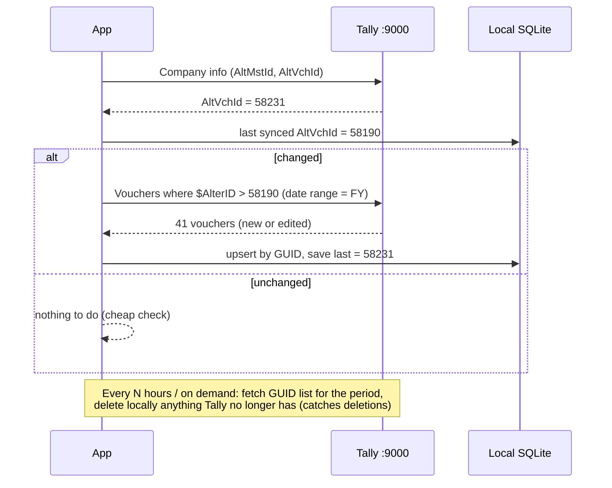

# 17 · Reading Tally: Sync Engine & Company Workspace

> **Question:** third-party apps show old Tally records and party details. The accountant opens a company, sees its data, and records sales/purchases from inside the app. How does that work?

## 17.1 How it works

**The same XML server on port 9000 also answers *read* requests.** The apps don't read Tally's data files. They:

1. **Ask Tally** for companies, ledgers and vouchers with `Export` requests (often with a small inline TDL collection).
2. **Copy the answer into their own local database** (Livekeeping keeps `lkdc.db` (SQLite); TrulyInvoice has its own `db`).
3. **Show screens from that local copy**, which is fast even on a slow PC.
4. **Fetch only what changed** since last time, using Tally's **AlterID**.
5. **Write new entries** with an `Import` request (doc 07), then re-sync so the new entry appears in their list.

### Evidence from this PC (`tallyhttp.log`, first 400k lines)

| Request seen | Count | Meaning |
|---|---|---|
| `SVFROMDATE` | 66,063 | Voucher reads always carry a date range |
| `ALTERID` / `AlterIdFilterNew` / `filterAlterID` | ~28,000 | **Incremental sync**: "only records changed after AlterID N" |
| `My Ledger Outstandings` | 15,685 | Party balances / pending bills |
| `ListOfVouchers` | 1,105 | Voucher list (Day Book style) |
| `LK_CompanyWiseSales / Purc / Receipts / Payment / Contra / Journal` | 940 / 255 / 579 / 422 / 108 / 46 | One pull per voucher type |
| `My Trial Balance / Balance Sheet / P&L / Group Summary` | 525 each | Reports for their mobile app |
| `filterIsdeleted` | 310 | Detect deleted vouchers |
| `TSPL__TallyAI__XMLListofSimpleCompanies` | 25 | Tally's own AI listing companies (same mechanism) |

So "seeing old records" is simply **a local mirror of Tally, kept fresh by AlterID**.

## 17.2 What AlterID is

- Every master (ledger, item) and every voucher in a Tally company has an **AlterID**. The company keeps a running counter that **increases on every create or edit**.
- The company exposes its latest values (`$AltMstId` for masters, `$AltVchId` for vouchers. Verify the exact method names on 7.1 in Sprint 0).
- Sync loop:



**Deletions:** a deleted voucher doesn't come back in an "AlterID > N" query. Run a periodic light **GUID-only reconcile** for the period and remove local rows that are no longer in Tally.

## 17.3 XML for reads

### Company details + change counters
```xml
<ENVELOPE>
 <HEADER><VERSION>1</VERSION><TALLYREQUEST>Export</TALLYREQUEST><TYPE>Collection</TYPE><ID>CmpInfo</ID></HEADER>
 <BODY><DESC>
  <STATICVARIABLES><SVEXPORTFORMAT>$$SysName:XML</SVEXPORTFORMAT></STATICVARIABLES>
  <TDL><TDLMESSAGE>
   <COLLECTION NAME="CmpInfo" ISMODIFY="No">
    <TYPE>Company</TYPE>
    <FETCH>Name, GUID, StartingFrom, BooksFrom, Address, StateName, Email, PhoneNumber, AltMstId, AltVchId</FETCH>
   </COLLECTION>
  </TDLMESSAGE></TDL>
 </DESC></BODY>
</ENVELOPE>
```
(GSTIN sits under the company's GST registration sub-objects in Prime 3.0+. Export one company to confirm the 7.1 path.)

### Ledgers with party details, incremental
```xml
<COLLECTION NAME="LedSync" ISMODIFY="No">
 <TYPE>Ledger</TYPE>
 <FETCH>Name, GUID, AlterID, Parent, Address, LedStateName, PinCode, Email, LedgerPhone, LedgerMobile,
        LedgerContact, IncomeTaxNumber, LedGSTRegDetails.*, OpeningBalance, ClosingBalance, IsBillWiseOn</FETCH>
 <FILTER>AfterAlter</FILTER>
</COLLECTION>
<SYSTEM TYPE="Formulae" NAME="AfterAlter">$AlterID > 1234</SYSTEM>
```

### Vouchers, incremental (needs a date range)
```xml
<STATICVARIABLES>
 <SVEXPORTFORMAT>$$SysName:XML</SVEXPORTFORMAT>
 <SVCURRENTCOMPANY>{COMPANY}</SVCURRENTCOMPANY>
 <SVFROMDATE>20250401</SVFROMDATE><SVTODATE>20260331</SVTODATE>
</STATICVARIABLES>
...
<COLLECTION NAME="VchSync" ISMODIFY="No">
 <TYPE>Voucher</TYPE>
 <FETCH>GUID, MasterID, AlterID, Date, VoucherTypeName, VoucherNumber, Reference, PartyLedgerName,
        Narration, IsCancelled, IsOptional, AllLedgerEntries.LedgerName, AllLedgerEntries.Amount,
        AllLedgerEntries.BillAllocations.*, AllInventoryEntries.*</FETCH>
 <FILTER>AfterAlter</FILTER>
</COLLECTION>
<SYSTEM TYPE="Formulae" NAME="AfterAlter">$AlterID > 58190</SYSTEM>
```

### Outstandings (receivables / payables)
Use the `Bills` collection (pending bills per party), or the built-in report `Ledger Outstandings` / `Bills Receivable` exported as XML.

### Rules for reads
- **One request at a time** and small pages (e.g. one month of vouchers per call). Huge single reads freeze Tally's UI.
- **Don't poll aggressively.** Check the cheap counters (AltVchId) every 30–60 s while the app is focused, and do the real pull only when they change. The 185 MB HTTP log and the TallyAI socket errors on this PC are what over-polling looks like.
- A company must be **loaded in Tally** to be readable. `tally.ini` here already auto-loads companies (`Default Companies=Yes`).

## 17.4 Local mirror: new tables (added to doc 15)

| Table | Content |
|---|---|
| `sync_state` | per company × object (`masters`, `vouchers`): last AlterID, last full reconcile, last error |
| `ledgers` (extended) | + address, state, pincode, phone, mobile, email, contact person, PAN, opening balance, `alter_id` |
| `companies` (extended) | + address, phone, email, `alt_mst_id`, `alt_vch_id` |
| `tally_vouchers` | full voucher header mirror (GUID, master_id, alter_id, type, base type, date, number, reference, party, narration, amount, cancelled/optional flags) |
| `tally_voucher_lines` | ledger lines of mirrored vouchers (ledger, amount, bill refs) |
| `tally_inventory_lines` | item lines (item, qty, rate, amount), only if inventory screens are needed |

`tally_vouchers` **replaces** the lighter `tally_voucher_index` from doc 15. The duplicate check and the bank matching both run on it.

## 17.5 The Company Workspace (UX)

```
┌─────────────────────────────────────────────────────────────────────────────┐
│ ◀ All companies   Client A – 2025-26        ● Synced 10 s ago   ⟳  [+ New ▼]│
├───────────┬─────────────────────────────────────────────────────────────────┤
│ Overview  │  Sales (Apr–Oct)   ₹ 48,20,500   Purchase ₹ 39,11,200           │
│ Day Book  │  Receivable        ₹ 6,45,000    Payable  ₹ 3,02,700            │
│ Parties   │  Bank last entry   18-Oct (SBI CC)   Cash ₹ 12,300               │
│ Sales     │ ─────────────────────────────────────────────────────────────── │
│ Purchase  │  Recent vouchers                                                │
│ Bank      │  24-Oct  Sales     INV-412   ABC Traders        ₹ 11,800.00     │
│ Notes     │  24-Oct  Receipt   RC-201    XYZ Agencies       ₹ 50,000.00     │
│ Imports   │  23-Oct  Purchase  PB-77     Om Distributors    ₹ 1,02,400.00   │
└───────────┴─────────────────────────────────────────────────────────────────┘
```

1. **Company list (home):** every company loaded in Tally, with a sync status, last entry date and pending work ("Bank done till 31-Aug").
2. **Open a company** → **Overview** with sales/purchase totals, receivables/payables and recent vouchers, all from the local mirror.
3. **Day Book / Sales / Purchase / Bank** lists: searchable and filterable by date, party or amount. Click a row to see the voucher detail.
4. **Parties:** ledger list with GSTIN, phone, address, balance and pending bills. Click through to a party ledger statement.
5. **`+ New` menu** has two ways to create entries:
   - **Single entry form**: a fast keyboard form for one Sales/Purchase/Receipt/Payment/Credit Note, with party auto-complete from the mirror, GST auto-split and the party's last rates. It uses the same validator and push engine as imports (a "batch of 1").
   - **Import**: the existing Upload → Map → Review → Push flow (docs 08–10).
6. After any push, an **immediate incremental sync** makes the new vouchers appear in the lists within seconds.

**Edit / delete existing Tally vouchers:** v1 only allows this for vouchers *our app created* (identified by REMOTEID). Vouchers typed directly into Tally are read-only in our app, which avoids damaging hand-made entries. This can be revisited later.

## 17.6 Where it fits in the architecture

New package **`packages/sync`** sits between `tally-client` and `storage`:

```
apps/desktop ─► pipeline ─► tally-client ─► Tally :9000
     │              │
     └─► sync ──────┴─► storage (SQLite mirror)
```

- `sync` owns the polling scheduler, AlterID bookkeeping, upserts, deletion reconcile and per-company locks.
- `pipeline` calls `sync.refresh(companyId)` after every push.
- UI lists read **only** from SQLite (via TanStack Query). The UI never waits on Tally to render a list.
